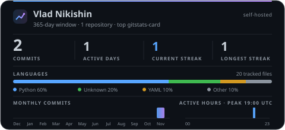

# gitstats-card

Self-hosted coding statistics for your GitHub profile, generated from the git
repositories on your own machine. No personal access token. No third-party
image generation service. No runtime dependencies beyond the Python standard
library.

[](https://github.com/h0shi-tech/gitstats-card/actions/workflows/ci.yml)
[](LICENSE)
[](https://www.python.org/downloads/)
[](#requirements)
[](#why-gitstats-card)



The committed preview was produced by this tool from a synthetic three-repository
demo. The scheduled workflow is set up to replace it with this repository's own
history.

## Why gitstats-card

Most coding-stat cards fetch data from a hosted API and render the image on
someone else's server. That is convenient, but it means a personal access token,
a network dependency, and an external service in your README.

`gitstats-card` takes the other route:

- reads local git history through ordinary `git` subprocesses;
- aggregates commits, active days, streaks, months, languages, hours, and
  repositories;
- renders a standalone, themeable SVG card;
- ships a GitHub Actions workflow that refreshes and commits the SVG on a
  schedule.

The SVG contains no scripts, remote fonts, images, or external references. It
renders through GitHub's image proxy and every other normal SVG viewer.

## Requirements

- Python 3.11 or newer
- Git installed and available on `PATH`
- No runtime Python dependencies

Running from a clone needs only `python3`. The optional editable install uses
setuptools as a build tool.

## Quick start

```bash
git clone https://github.com/h0shi-tech/gitstats-card.git
cd gitstats-card

python3 -m gitstats_card \
  --path "$HOME/code" \
  --days 365 \
  --title "Vlad Nikishin" \
  --out assets/stats.svg
```

`--path` accepts either a repository or a directory that contains repositories.
Directories are searched recursively. Discovery does not descend into a
repository it has already found, so nested checkouts are not double-counted.
Repeat `--path` to scan multiple roots:

```bash
python3 -m gitstats_card \
  --path "$HOME/code" \
  --path "$HOME/work" \
  --exclude "archive/*" \
  --days 365 \
  --theme light \
  --title "Vlad Nikishin" \
  --out assets/stats.svg
```

The output directory is created if necessary. Progress and warnings go to
stderr; the card is written to `--out` (default: `assets/stats.svg`).

To install the `gitstats-card` command:

```bash
python3 -m pip install -e .
gitstats-card --path "$HOME/code" --out assets/stats.svg
```

### CLI reference

| Option | Meaning |
| --- | --- |
| `--path DIR` | Repository or scan root. Repeatable. Defaults to the current directory. |
| `--out FILE` | SVG destination. Defaults to `assets/stats.svg`. |
| `--theme dark\|light` | Card palette. Defaults to `dark`. |
| `--title TEXT` | Card title. Defaults to `Coding Stats`. |
| `--days N` | Rolling window in days. Defaults to `365`. Requires a positive integer. |
| `--exclude GLOB` | Skip repositories whose name, path relative to the scan root, or absolute path matches. Repeatable. |
| `--author TEXT` | Count only commits whose author name or email contains `TEXT`, case-insensitively. |
| `--generated-at ISO8601` | Freeze the window/streak reference time and show its date on the card. |
| `--json` | Print the raw aggregate dictionary to stdout. |
| `--markdown-snippet` | Print `` to stdout. |
| `--version` | Print the version. |

The SVG is always written to `--out`. `--json` and `--markdown-snippet`
additionally write to stdout, and are mutually exclusive. Progress and warnings
never go to stdout.

The markdown snippet is tied to the default `assets/stats.svg` path:

```markdown

```

If you choose another output path, adjust the snippet accordingly.

To inspect the raw numbers without parsing the SVG:

```bash
python3 -m gitstats_card --path "$HOME/code" --json > stats.json
```

The JSON document includes:

- `totals` — commits, active days, current streak, longest streak, repositories;
- `window` — days, inclusive bounds, and timezone;
- `months` — twelve monthly buckets used for the strip;
- `commits_by_hour` — 24 UTC buckets;
- `languages` — tracked file counts by language;
- `repositories` — per-repository commit counts;
- `top_repositories` — the top five by commits.

## How the card is produced in CI

Two workflows are included:

- `.github/workflows/ci.yml` compiles the package and runs the test suite on
  Python 3.11, 3.12, and 3.13.
- `.github/workflows/stats.yml` refreshes `assets/stats.svg` daily at 04:23 UTC
  and on manual dispatch.

The refresh workflow:

1. checks out the repository's default branch with full history;
2. runs `python -m gitstats_card --path . --days 365 --author "Vlad" --out assets/stats.svg`;
3. commits the result only if the bytes changed;
4. pushes the commit back to the same default branch.

The commit uses the standard `github-actions[bot]` identity and the workflow's
own `GITHUB_TOKEN` (`contents: write`). No personal access token is needed.
Concurrency is serialized so two refreshes cannot race. The workflow filters
commits to the identity containing `Vlad` so the bot's own card-refresh commits
do not inflate the statistics; change the `--author` value in `stats.yml` to
your own git identity.

GitHub-hosted runners can only analyze repositories that are checked out in the
job. The supplied workflow analyzes the repository that contains it. To include
more repositories, add checkout steps with distinct `path:` values and pass each
path to the CLI:

```yaml
- uses: actions/checkout@v4
  with:
    repository: <owner>/<other-repo>
    path: repos/other-repo

- run: |
    python -m gitstats_card \
      --path . \
      --path repos/other-repo \
      --out assets/stats.svg
```

For a profile README, reference the committed asset by its raw URL:

```markdown

```

For example, if this repository lives at `h0shi-tech/gitstats-card`:

```markdown

```

The image is served by GitHub's raw-content endpoint; the card itself does not
contact any external service. GitHub may cache README images briefly after a
refresh. If the default branch is protected against bot pushes, configure the
ruleset to allow `github-actions[bot]`, or commit the generated SVG locally.

## Measurement rules

The exact rules matter if you compare the numbers with another tool.

- **Window:** commits are counted when their committer timestamp falls inside
  `[generated_at - days, generated_at]`, inclusive. Generation uses the current
  UTC time unless `--generated-at` is supplied.
- **Time zone:** all calendar work is in UTC. Commit hours and dates are derived
  after converting the git timestamp to UTC.
- **History:** `git log HEAD` is used. Commits on the checked-out branch are
  counted, merge commits included; unmerged branch commits are not. Detached
  HEAD is supported.
- **Streaks:** an active day is a UTC calendar date with at least one counted
  commit. The current streak counts consecutive active dates backwards from the
  reference date. Because the current UTC day is not over while the card is
  generated, it may end yesterday when there is no commit today; it is `0` only
  when neither today nor yesterday has a commit. The longest streak is the
  longest run anywhere in the selected window. Both are therefore
  window-scoped.
- **Months:** the strip always shows the 12 UTC calendar months ending with the
  reference month, including zero-count months.
- **Languages:** every path from `git ls-files -z` is counted once, classified
  by its final extension using a built-in extension-to-language table.
  Unrecognised extensions and extensionless files go to `Unknown`. This is a
  file mix, not a line-of-code measure. It describes the current index and is
  not filtered by `--author` or `--days`.
- **Repositories:** the top five are ordered by counted commits, then name and
  path for deterministic ties.
- **Determinism:** rendering has no clock access. The same aggregate, theme,
  title, and generated-at value produce byte-identical SVG. Timestamps appear
  on the card only when `--generated-at` is supplied.

## Limitations

- Local repositories only. The tool does not call the GitHub API and cannot see
  repositories that are not on disk or checked out in the CI job.
- No line-of-code counting, per-language LOC, pull-request, issue, or star
  statistics.
- The card reflects the current HEAD of each repository, not every branch or
  the full GitHub contribution graph. Merge commits count like any other commit.
- UTC is the only time zone. Local-time day boundaries are not modelled.
- A commit is dated by its committer timestamp. Rewritten or rebased history
  changes the result.
- Longest and current streaks are limited to the selected `--days` window.
- Language counts include documentation, configuration, generated files, and
  vendored files if they are tracked.
- Large histories are bounded by `git log --since`, but the tracked-file index
  is read in full to calculate the language mix.
- A GitHub Actions job sees only checked-out repositories. The default workflow
  does not aggregate your entire machine.
- Branch protection can reject the workflow's push. The workflow then fails
  visibly rather than silently skipping the update.
- The committed preview is a synthetic sample, not a claim about a live GitHub
  profile. The workflow replaces it on its first run.

## Development

```bash
make check
```

or run the two checks directly:

```bash
python3 -m compileall -q gitstats_card tests
python3 -m unittest discover -s tests -v
```

The test suite builds disposable repositories with `tempfile.mkdtemp()` and
fixed `GIT_AUTHOR_DATE`/`GIT_COMMITTER_DATE` values. It runs offline and covers
streak math, month bucketing, author filtering, language classification,
detached HEAD, empty repositories, escaping, deterministic rendering, CLI exit
codes, and a missing `git` executable.

```
gitstats_card/
  __init__.py
  __main__.py
  cli.py        CLI, validation, and exit codes
  collect.py    discovery, safe git subprocesses, NUL parsing
  stats.py      pure UTC aggregation
  svg.py        pure deterministic SVG rendering
tests/
  support.py    disposable git repository helpers
  test_*.py     collection, stats, SVG, and CLI tests
.github/workflows/
  ci.yml        compile, test, CLI smoke test
  stats.yml     scheduled card refresh and commit
assets/
  stats.svg     committed sample output
```

## License

MIT. Copyright (c) 2026 Vlad Nikishin. See [LICENSE](LICENSE).

The CI badge targets the repository at `h0shi-tech/gitstats-card`; update the
badge and repository URLs if you publish a fork under another name.
